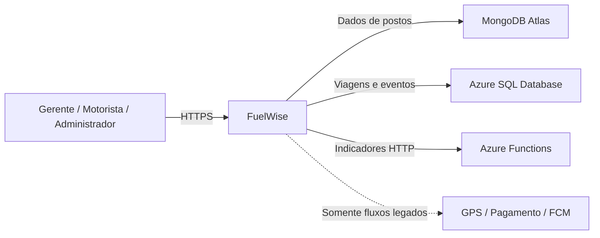
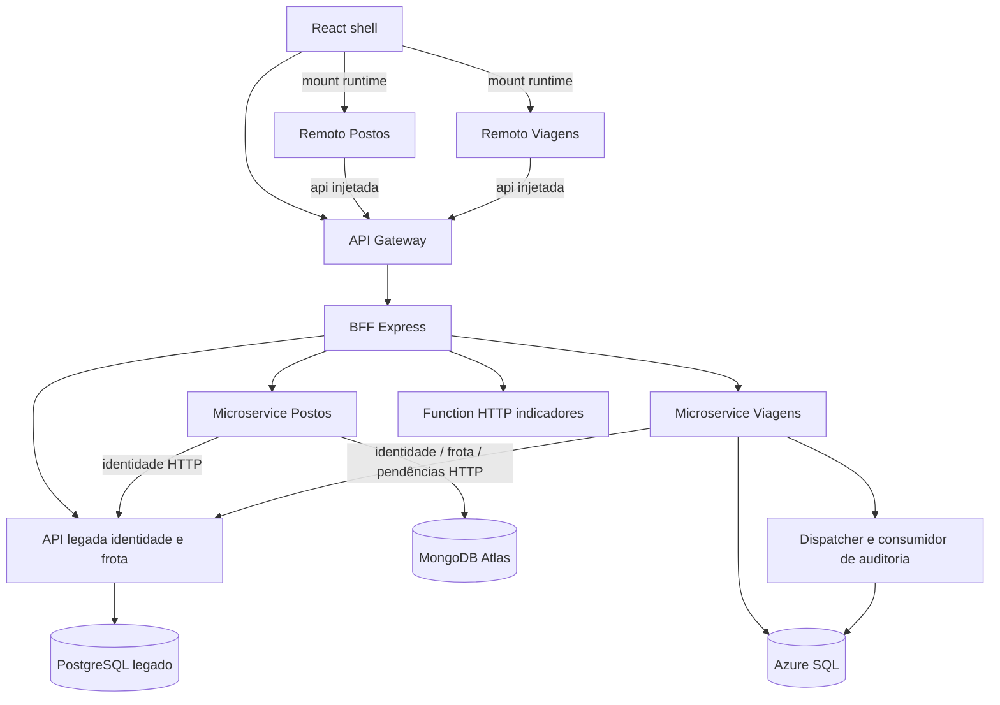
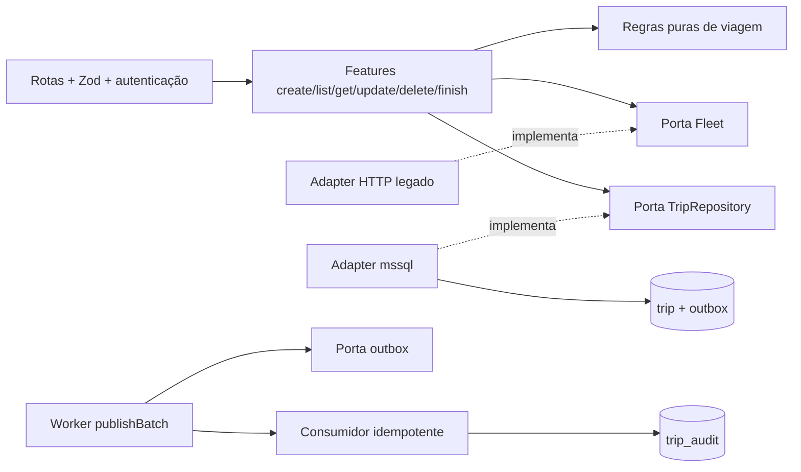
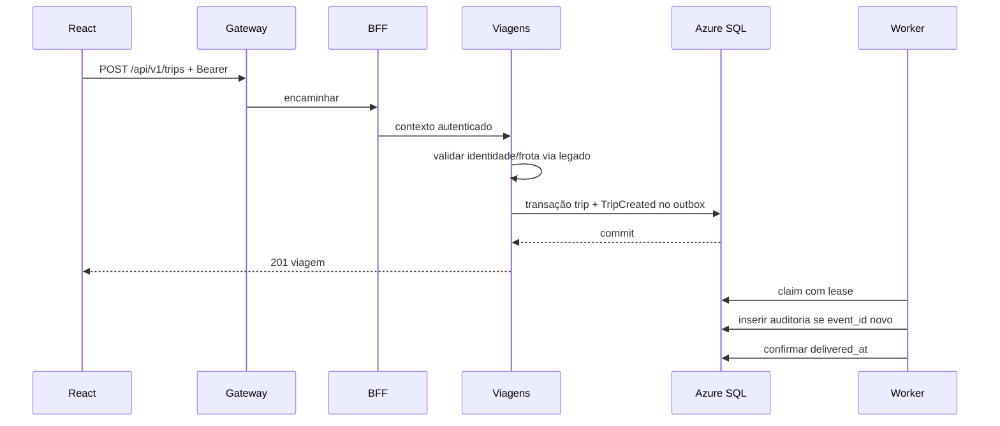

# FuelWise — Arquitetura da Entrega 3

PUCPR · Engenharia de Software · Arquitetura e Soluções Cloud

Artur Ribeiro de Souza · Cristhian Rezende · Lucas Andriani Theiss · Vinicius da Rosa Padilha

Versão de implementação e publicação de código, 11/11/2026. Os repositórios e
imagens Docker estão públicos; os serviços ainda não têm URLs de execução cloud.
O vídeo permanece pendente do grupo.
Referência: documentação original da Entrega 2 (53 páginas), enunciado e prompt
da Entrega 3. O código e os resultados registrados em VALIDATION.md prevalecem
sobre propostas. Não há URL pública inventada; consultar PUBLIC_URLS.md.

## 1. Introdução e objetivos

FuelWise centraliza a gestão de combustível e frota de transportadoras pequenas
e médias. Gerentes administram motoristas/veículos/viagens e aprovam despesas;
motoristas consultam postos e operam suas viagens; administradores aprovam
transportadoras, mantêm postos e auditam o sistema.

Esta entrega acrescenta dois microservices, BFF, gateway, microfrontends React,
Azure Function HTTP e processamento assíncrono. O fluxo demonstrável é CRUD de
postos e viagens, agregação de indicadores e auditoria de eventos. O financeiro
legado conserva suas regras e sua execução original; não foi distribuído.

Prioridades: segurança por perfil/transportadora, integridade e idempotência,
testabilidade, operação demonstrável sem custos não autorizados. Disponibilidade
99% e p95 até 2 s do PDF continuam metas, não resultados medidos.

### Rastreabilidade

| RF | Responsável nesta versão |
|---|---|
| RF01, RF02, RF14 | Legado: solicitação, gerente, aprovação/recusa |
| RF03, RF04 | Legado: cadastro mestre de motorista e veículo |
| RF05, RF06 | Mongo: postos e histórico de preços no modo distribuído |
| RF07 | Azure SQL: viagem, exclusividade, estado e desativação |
| RF08 | GPS legado, com mock/cache; não foi migrado para viagens novas |
| RF09–RF11 | Mongo: geolocalização/filiados/detalhes; consulta externa legado preservada no modo original |
| RF12, RF13 | Financeiro legado; indicadores da amostra via Function; auditoria de viagens via eventos |
| RF15, RF16 | Abastecimento/pagamento/denúncia preservados no modo original |

Detalhamento dos contratos anteriores: REQUIREMENTS.md e API.md.

## 2. Restrições arquiteturais

Dois microservices obrigatórios: MongoDB Atlas Free e Azure SQL Database em
oferta gratuita elegível. SQL Server local serve exclusivamente para testes.
Node 22/ESM/Express e padrões Vertical Slice/Clean Architecture são mantidos.
Frontend não acessa bancos nem serviços diretamente; BFF não possui driver de
banco. Nenhum recurso pago, crédito estudantil ou repositório público é criado
automaticamente. CLOUD_COSTS.md registra limites e bloqueios de elegibilidade.

O “Free 1 DTU” do enunciado não exige contratar SKU pago: a oferta atual
documentada usa vCore-segundos. Quatro microservices do PDF são arquitetura
futura e não são implementados nesta entrega.

## 3. Contexto e escopo (C4 Contexto)

Os provedores externos continuam adaptadores de referência e mocks explícitos
na homologação original. O novo fluxo não depende de pagamento comercial.

## 4. Estratégia de solução

Extrair contratos e regras, manter o repositório original e criar cinco projetos
exportáveis. Identity lookup HTTP reutiliza JWT, perfil e estado ativo do legado.
Todos os filtros de tenant vêm da identidade validada; não de campos do cliente.

Dois modos de operação: original (todos os slices/PostgreSQL) e distribuído
(novos donos de postos e viagens). No distribuído, o legado encaminha as rotas
extraídas e recusa inicializar sobre domínios PostgreSQL já preenchidos. Evita
uma migração silenciosa ou duas cópias graváveis. A migração de dados e ponte
financeira exige trabalho adicional antes de uso com instalações existentes.

## 5. Blocos de construção (C4 Contêineres)

O legado e seu banco são infraestrutura de transição, não um terceiro
microservice extraído. As duas fronteiras de negócio novas são Postos e Viagens.
Não existe leitura direta de um banco por outro serviço.

### C4 Componentes — Viagens

Composition roots constroem adapters. Domain/application/useCase não importam
Express ou drivers; testes estáticos verificam dependências e ciclos. Features
organizam mudanças por caso de uso; infraestrutura implementa portas pequenas.

## 6. Tempo de execução

Agregação: BFF consulta Postos e Viagens concorrentemente, envia arrays à Function
e retorna indicadores + dados. Até 100 registros por serviço, declarado como
amostra. Falha parcial retorna 207, null e mensagens; falha de autenticação
retorna 401. Nenhum zero é inventado para um serviço indisponível.

Atualização de viagem permite observações, mantendo motorista/veículo imutáveis.
Finalização exige IN_PROGRESS e ausência de pendências; DELETE somente desativa
viagem FINISHED. Índices únicos impedem viagens ativas concorrentes. O modo
distribuído ainda não aceita abastecimentos novos do financeiro legado, portanto
a ponte de concorrência financeira não deve ser considerada homologada.

## 7. Implantação

Local: Docker Compose isolado, PostgreSQL, Mongo e SQL Server Developer;
containers independentes dos componentes. Function usa handler com adapter
Node no Compose padrão; overlay opcional validado com host oficial Node 22,
chave de função e Azurite local. Dados persistem em volumes; credenciais em
arquivo ignorado. Gateway em localhost:18080 e frontend :5173.

Homologação de dados cloud real: Atlas M0 e `fuelwiseDB` Azure SQL; suites de
CRUD/outbox e smoke E2E passaram, com limpeza dos registros. O gateway, frontend,
BFF e serviços ainda não foram hospedados em URL pública. A Azure Function foi
testada no host local oficial com Azurite; ainda não há Function App cloud. A
oferta de Function Consumption não comprova custo zero para Storage, e a API
gerenciada do Static Web Apps tem runtime diferente do Node 22 atual; ver
CLOUD_COSTS.md antes de escolher. Publicações de código/imagens estão em
PUBLIC_URLS.md. Todas as futuras URLs de execução devem usar HTTPS.

Cada projeto possui README/package/lockfile; Dockerfiles de BFF/Mongo/SQL usam
usuário node e health checks. CI executa testes, build frontend e smoke Compose.

### Links da publicação verificada

| Projeto / imagem | URL pública |
|---|---|
| Repositório raiz | [FuelWise Architecture](https://github.com/LucasTheiss/fuelwise-architecture/tree/vertical-slice) |
| Microfrontend | [fuelwise-frontend](https://github.com/CristhianSK/fuelwise-frontend) |
| BFF | [fuelwise-bff](https://github.com/CristhianSK/fuelwise-bff) |
| Microservice Mongo | [fuelwise-microservice-mongo](https://github.com/CristhianSK/fuelwise-microservice-mongo) |
| Microservice SQL | [fuelwise-microservice-sql](https://github.com/CristhianSK/fuelwise-microservice-sql) |
| Azure Function | [fuelwise-azure-function](https://github.com/CristhianSK/fuelwise-azure-function) |
| Imagem BFF | [cristhiansk/fuelwise-bff:v1](https://hub.docker.com/r/cristhiansk/fuelwise-bff/tags) |
| Imagem Mongo | [cristhiansk/fuelwise-mongo-service:v1](https://hub.docker.com/r/cristhiansk/fuelwise-mongo-service/tags) |
| Imagem SQL | [cristhiansk/fuelwise-sql-service:v1](https://hub.docker.com/r/cristhiansk/fuelwise-sql-service/tags) |

Frontend, gateway, Swagger e Function ainda não têm URLs públicas de execução.
O AsyncAPI está disponível no repositório em `docs/asyncapi.json`; o vídeo será
adicionado pelo grupo após a gravação.

## 8. Conceitos transversais

- Segurança: Bearer validado pelo legado, RBAC e tenant; sem credenciais no
  frontend; token em memória; destinos do proxy fixos; CORS explícito.
- Persistência: UUID, parâmetros SQL tipados, pool limitado, TLS validado no
  Azure; sem exclusão física no CRUD; preços históricos com três casas.
- Eventos: outbox transacional, lease 60 s, entrega pelo menos uma vez, retry
  exponencial até cinco tentativas, dead letter, deduplicação atômica event_id.
- Observabilidade: logs JSON por componente, health/readiness, auditoria por
  transportadora e AsyncAPI. Não registrar tokens ou connection strings.
- Resiliência: timeout HTTP, erros padronizados, sem retry automático de CRUD;
  falhas parciais visíveis. Original financeiro preserva UNKNOWN/idempotência.
- UI: shell e dois ES modules independentes; contrato versionado mount/unmount,
  API injetada pelo shell, sem URLs de serviço nos remotos.

## 9. Decisões arquiteturais

| Decisão | Motivo / consequência |
|---|---|
| Dois serviços em vez dos quatro propostos | Escopo obrigatório da Entrega 3; financeiro permanece no legado |
| Driver Mongo e mssql explícitos | Controle de persistência, queries parametrizadas e teste dos adapters |
| Identidade HTTP reaproveitada | Conta desativada/transportadora bloqueada têm efeito imediato; dependência do legado |
| Outbox + worker sem broker pago | Publicação/consumo reais sem Service Bus; operação em uma fronteira de serviço |
| ES modules com mount/unmount | Deploy independente dos remotos sem infraestrutura de federation; React por raiz |
| Reverse proxy Node independente | Gateway real gratuito, TLS configurável e limites; rate limit em memória para uma instância |
| Modo distribuído exige domínios legados vazios | Impede perda/split-brain; migração de produção explicitamente pendente |

As decisões de cálculo monetário, aprovação, reserva antes da cobrança,
idempotência e conciliação do PDF continuam válidas no legado.

## 10. Requisitos de qualidade

| Cenário | Critério / validação |
|---|---|
| Token ausente/inválido | 401, sem consulta indevida |
| Perfil não autorizado | 403 para mutações de outro perfil |
| Outra transportadora | 404, sem revelar entidade |
| Segunda viagem ativa | 409 garantido por índice SQL |
| Evento entregue duas vezes | Uma auditoria por event_id |
| Serviço fora do ar | Timeout e erro/resultado parcial explícito |
| Import de driver no domínio | CI falha |
| Remoto atualizado | Build próprio, shell carrega URL configurada |

Resultados efetivamente executados estão em VALIDATION.md. Testes locais não
atestam SLA, capacidade, segurança de produção ou integração cloud.

## 11. Riscos e débitos técnicos

Repositórios/imagens públicos e integrações reais Atlas/Azure foram validados.
Deploy dos serviços, Function cloud e screenshots cloud seguem pendentes. O
link do vídeo será preenchido pelo grupo.
Gratuidade da Function/storage exige comprovação. Free hosts têm cold start,
quotas e suspensão; polling de outbox pode impedir pausa SQL.
Rate limit do gateway é por processo. BFF limita dashboard a 100 registros.
Migração financeira/denúncias/GPS para novas entidades não implementada; operação
original continua separada. Não há rollback distribuído de pagamentos.
Produção depende de teste de carga, backup/restauração, revisão de ameaças e
observabilidade operacional. Ver PUBLIC_URLS.md, CLOUD_COSTS.md e DEMO_SCRIPT.md.
